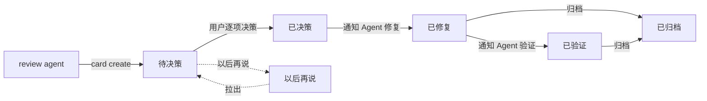

# herdr-review

给 herdr-app 桌面端用的代码 review 插件：agent 提交 review 结论，你在 Review 面板里逐项决策，再交给 agent 修复和验证，全程留档。


## 功能

- **Review 面板**：停靠在 herdr-app 右侧，按 space → worktree → review 卡 → 条目分组，和侧栏层级一致。
- **逐项决策**：每条结论可以选择通过、不通过或以后再说，可以写备注，操作后底部可撤销。
- **整卡流转**：卡片按里面条目的状态自动归入"待决策 / 已决策 / 已修复 / 以后再说"，以后再说的项拆成副本卡，不挡住原卡。
- **交给 agent**：在面板上选一个正在运行的 Claude Code、Codex，或新开一个，把修复或验证任务直接发过去。
- **验证与归档**：修复后可以请 agent 验证，结果标为"已验证"或"验证未通过"；已修复的卡归档后在"已归档"页只读查看。
- **重复问题合并**：新一轮 review 提出的旧问题记到原条目上，不重复决策。
- **只允许用户决策**：通过、不通过、归档等操作会核对调用者身份，agent 调用会被拒绝。

## 工作流程



1. review agent 独立完成 review，用 `herdr-review card create` 提交结论；如有同一 worktree 的未修复旧项，比对后用 `card publish` 发布。
2. 你在面板上逐项决策，选一个 agent 修复。
3. 修复 agent 用 `herdr-review todo` 查看要修的项，修完用 `item fixed` 标记。
4. 需要时请 agent 验证，验证 agent 用 `verify` 查看、用 `item verify` 标记结果。
5. 确认无误后归档。

## 环境要求

- herdr-app 桌面端（带 `hc` 命令）
- Node.js 22.18 或更高版本（直接运行 TypeScript，不需要编译）
- Git（用来判断卡片属于哪个仓库和 worktree）

## 安装

```bash
git clone https://github.com/DawsonLiu1996/herdrapp-review.git
cd herdrapp-review
node cli/src/cli.ts setup
```

setup 会安装：

- `herdr-review` 命令入口（放在 PATH 里的 `~/.local/bin` 等目录，也可以用 `--bin <目录>` 指定）
- Review 面板（`mods/review`）、带 Review 按钮的标签栏（`mods/review-tabs`）和 review 布局
- 快捷键 `Ctrl+Shift+R`：显示或隐藏面板
- Claude Code 和 Codex 的 `herdr-review` 技能

| 参数 | 作用 |
| --- | --- |
| `--rules` | 同时把常驻规则写入 `~/.claude/CLAUDE.md` 和 `~/.codex/AGENTS.md`；不带时只打印规则内容 |
| `--dry-run` | 只列出会做什么，不改动文件 |
| `--uninstall` | 撤销安装，review 数据保留 |
| `--bin <目录>` | 指定命令入口所在目录 |

## 使用

agent 不确定用法时运行 `herdr-review` 查看流程，运行 `herdr-review schema` 查看提交格式。一条结论包含标题、严重程度（P0–P3）、位置、问题、建议修法、影响场景和影响点。

```bash
herdr-review card create --file review.json   # 提交本轮结论
herdr-review card publish R16 --same R16-3=R12-2   # 比对后发布，标出重复项
herdr-review todo                              # 修复 agent：查看要修的项
herdr-review item fixed R12-1 --note "改了什么" --commit abc123
herdr-review verify                            # 验证 agent：查看待验证的项
herdr-review item verify R12-1 --pass
herdr-review item verify R12-2 --fail --note "直接访问地址仍能进入"
herdr-review wait                              # review agent：等用户决策完
```

| 退出码 | 含义 |
| --- | --- |
| 0 | 成功 |
| 2 | 提交内容不合格，按提示修改后重新提交 |
| 3 | 权限不足（例如 agent 执行用户操作）或等待超时 |
| 4 | 编号或状态不对 |

## 数据

- 卡片存放在 `~/.config/herdr-app/review/cards/`，每张卡一个 JSON 文件；设置了 `HERDR_APP_HOME` 时跟随它。
- 只有 `herdr-review` 命令写入数据：先获取目录锁，写临时文件后改名替换。面板只读文件，写操作也调用命令。
- 删除的卡放在 `review/trash/`，可以用 `herdr-review card restore <卡号>` 恢复。

## 开发

```bash
npm install          # 只安装类型检查用的 TypeScript 和 @types/node
npm test             # 端到端测试（node --test）
npm run typecheck    # 类型检查
herdr-app check mod/review   # 检查面板能否加载
```

改了 `mod/` 或 `agent-assets/` 后重新运行 `node cli/src/cli.ts setup`，herdr-app 会自动重载面板。

```text
cli/
  src/cli.ts         命令入口和全部子命令
  src/model.ts       数据结构和条目状态流转
  src/store.ts       卡片读写、目录锁、编号、副本卡
  src/context.ts     识别调用者所在的终端、space 和 Git 仓库
  src/setup.ts       安装和卸载
  test/              测试
mod/
  review/            Review 面板（main.js）、共用数据层（review-core.js）、阶段规则（lifecycle.js）
  review-tabs/       herdr-app 自带标签栏的复制，加了 Review 按钮
layout/review.json   review 布局
agent-assets/        agent 技能和常驻规则
docs/design.md       设计说明
```

`lifecycle.js` 同时被命令和面板使用，保证两边对卡片所在栏目的判断一致。herdr-app 不允许 mod 引用其他 mod 的文件，setup 会把 `review-core.js` 和 `lifecycle.js` 复制到两个 mod 里。

更多设计细节见 [docs/design.md](docs/design.md)。
