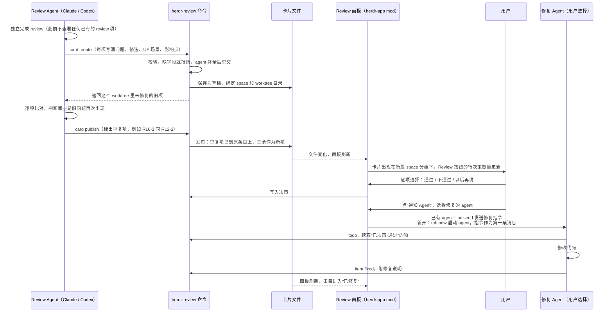
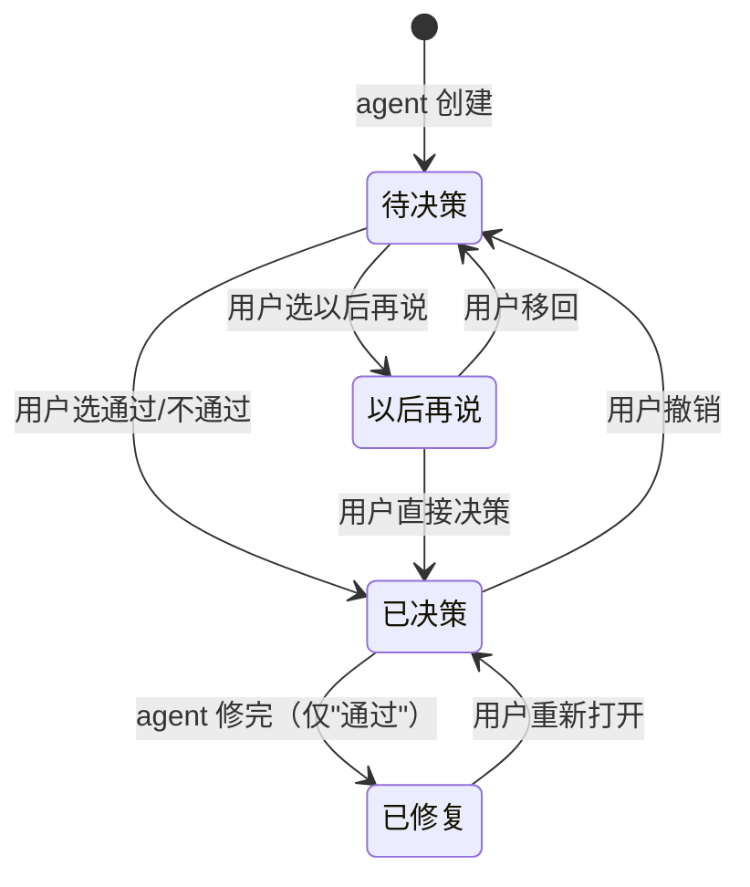
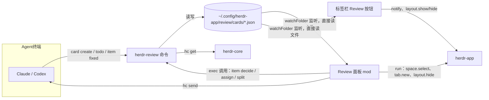

# herdr-app Review 卡设计方案

> 版本：v0.4（生命周期改造）　日期：2026-11-05　环境：herdr-app 0.1.13、herdr-core（hc）0.1.17、Node 24、Windows 11

## 1. 要点

- herdr-app 桌面端提供 **mod 机制**：在 `~/.config/herdr-app/mods/<名称>/` 放一个 JavaScript 程序，就能做出原生界面的面板，可以停靠在窗口右侧、做成弹窗或独立小窗口，也能弹通知。界面能力与自带的 Files、Changes 面板相同。
- Review 面板是 herdr-app 的**公共面板**：切换到任何 space 或 worktree 都在，内容不随当前 space 变化。标签栏 Files、Changes 旁边加一个 **Review 开关按钮**，用来显示或隐藏面板，按钮上显示待决策数量。
- 面板里的卡片按**与侧栏一致的层级**排列：space → worktree → review 卡 → review 项。space 下可以直接有卡，也可以有 worktree。卡片所属的 space 或 worktree 没有在侧栏打开时，这张卡不显示；重新打开后自动出现。
- agent 在 herdr-app 的终端里运行时，带有环境变量 `HC_TERMINAL_ID`。用 `hc get` 可以查到它所在 space 的 id（标签 `herdr.space`）和 agent 类型（`claude-code`、`codex`）。卡片据此绑定到 space，同时记录 worktree 目录作为备用匹配。
- `HC_TERMINAL_ID` 对 Codex 不可信：Codex 的多个窗口共用一个后台进程，命令继承的是启动这个后台进程的那个窗口的编号。那个窗口退出 Codex 后后台进程仍在，这个编号指向的是一个普通 shell。
  - 认出 Codex：Codex 给它运行的每条命令设置环境变量 `CODEX_THREAD_ID`。有这个变量（或带 `--agent codex`）时按 Codex 处理，不看环境里的终端运行的是什么。否则普通 shell 会被当成用户，agent 就能代替用户决策。
  - 核对终端：在需要记录终端和 space 的命令（`card create`、`card list`、`todo`、`deferred`、`wait`、`item fixed`）中按下面顺序找调用者所在的窗口。
    1. 按对话名：`CODEX_THREAD_ID` 是对话编号，在 Codex 的对话索引（`~/.codex/session_index.jsonl`）里查到对话名。Codex 把对话名放在窗口标题开头（例如"审查项目代码 | herdr-review-plugin"），在运行 Codex 的终端里找标题以它开头的；不止一个时再按目录挑。
    2. 按目录（对话还没起名，或标题对不上时）：环境里的终端在运行 Codex 且目录包含调用目录时沿用；否则在运行 Codex 的终端里找目录等于或包含调用目录的那一个（取最深且唯一的）。
    3. 都找不到唯一的终端时，不沿用环境里的终端（它已确认不是调用者，space 属于别的项目）：终端记为未确认；候选终端都在同一个 space 时记这个 space，否则 space 也不记，面板按目录匹配。`card create` 的输出带 `notice` 说明这种情况。环境里的终端本身查不到（hc 出错或终端已不存在）且没找到其他候选时，沿用编号，此时本来就没有 space。
  - Claude Code 等每个窗口是独立进程，环境变量可信，不做改动。
  - 曾尝试按进程上下级核对，Windows 的 Git Bash 启动命令时会断开进程链，误判后改为现在的方式。
- **多轮 review 每轮一张卡**。重复问题由 agent 在提交本轮结论之后比对判断，插件不判断；agent 在 review 完成前不查看已有的 review 项。详见 2.2。
- **卡片按阶段归栏，不按条目过滤**（v0.4）。阶段由共用规则 `mod/review/lifecycle.js` 的 `cardStage` 计算：草稿不显示 → 已归档 → 无条目且有移出记录不显示 → 无条目已修复 → 全部暂缓"以后再说" → 有待决策项 → 有已决策·通过项 → 其余已修复。命令和面板用同一份规则，归栏结果一致。
- **"以后再说"的项移到副本卡**（v0.4）。`item decide --defer` 把项从原卡移到它的副本卡（`origin` 记原卡编号，卡头信息相同），原卡记 `moved`。从副本卡拉出时：全部选中就在副本卡里原地改状态（副本卡整体进入对应栏目），只拉出一部分时拉出的项组成新卡（`origin` 同副本卡）。拉出的卡再选"以后再说"时放回同一原卡的副本卡；没有副本卡且整卡放回时原地变回副本卡。面板撤销"以后再说"时带 `--restore`，条目按 `moved` 回到原卡。条目全部移走的副本卡、拉出的卡移到回收站。旧数据里留在普通卡中的暂缓项由迁移移到副本卡。
- **已修复的项要验证**（v0.4）。已修复卡头显示"Review → 修复 → 验证"和验证状态（无需修复 / 待验证 / 验证中 / 已验证 / 验证未通过）。用户点"通知 Agent"选验证 agent，agent 运行 `herdr-review verify` 查看待验证项，逐项用 `item verify --pass|--fail --note` 标记。重新打开和再次标记已修复会清空验证结果。
- **已修复的卡可以归档**（v0.4）。归档只允许用户、只对已修复阶段的卡，面板右上角常驻归档按钮（代替删除），底部可撤销（unarchive）。已归档页按 space → worktree 分组、按归档时间倒序、只读；已归档卡仍参与新卡的比对。
- 通知修复时由用户**选择修复的 agent**：点按钮后在旁边弹出小气泡，可以选卡片所属 space 或 worktree 里任意一个正在运行的 agent，也可以新开 Claude Code 或 Codex。负责 review 的 agent 会标出来，方便避开。
- **限制**：`herdr-app do review.xxx` 只能把命令名传给 mod，传不了卡片内容。所以 agent 提交卡片要用配套命令 `herdr-review`：它负责校验、存储，写入后面板通过文件监听立即刷新。
- 面板上的通过、不通过等操作也交给 `herdr-review` 执行，数据规则只放在一处。
- 推荐技术栈：mod 用 herdr-app 规定的 JavaScript（gpui-kit），`herdr-review` 用 TypeScript（Node 24），两边同一种语言。

## 2. 用户流程

### 2.1 主流程



### 2.2 多轮 review

同一个 agent 在同一个 worktree 里可能做多轮 review。规则如下：

1. **每轮一张卡**。每轮的范围和代码版本不同，分开记录便于追溯。卡片记下轮次：同一个 agent 终端在同一个 worktree 里的第几张卡。
2. **重复问题由 agent 判断**。插件不做相似度判断，也不做兜底检查。
3. **先 review，后比对**。agent 在 review 完成前不得查看已有的 review 项，避免旧结论影响本轮判断。流程上靠两点保证：
   - 旧项清单只在 `card create` 提交本轮结论之后返回，agent 不需要提前查看；
   - 提交后本轮结论的内容就固定了，比对阶段只能标出"哪条与哪条是同一问题"，不能修改结论内容。
4. **比对范围**：同一 worktree 里未修复的项，即待决策、已决策（通过或不通过）、以后再说。已修复的问题再次出现时按新问题处理。
5. **重复项的处理**：不新建条目，记到原条目上，原条目的状态不变。例如用户已标"不通过"的问题再次被提出，仍保持不通过，用户不用重复决策；面板在原条目上标"再次提出"。
6. **用户纠正**：agent 判断错时，用户在原条目上点"不是同一问题，拆成新问题"，这条恢复为本轮卡里的一条新问题，进入待决策。
7. **草稿超时**：没有旧项可比对时，`card create` 直接发布。agent 提交草稿后 30 分钟仍未发布（例如进程中断），草稿按"全部是新问题"发布（卡片数据记 `compared:false`，面板不显示这个标记），避免本轮结论丢失。面板和标签栏按钮每次定时读取都按当前时间判断草稿是否超时，超时就调用一次命令完成发布；卡片仍只由命令写入。

### 2.3 以后再说

1. 用户点"以后再说"，该项从原卡移到它的**副本卡**（v0.4）：副本卡记录 `origin` 为原卡编号、卡头信息与原卡相同，条目是暂缓项；原卡的 `moved` 记录移出了哪些项，卡底部灰字"N 项已移到以后再说"。没有副本卡时自动新建。副本卡整体进入"以后再说"栏，卡头标"来自以后再说"。
2. 用户在"以后再说"栏勾选若干项后，可以：
   - 移回待决策、直接选通过或不通过：**副本卡的项全部选中时在副本卡里原地改状态**（副本卡整体进入对应栏目）；**只选中一部分时，选中的项组成新卡**（`origin` 同副本卡，标"来自以后再说"），剩下的留在副本卡。
   - 复制所选：生成一段发给 agent 的文字（问题、修法、影响、位置、条目编号、用户备注），写入剪贴板。这些项用户还没有通过，文字写明"先用于讨论，不要修改代码"；要修复请先通过，或用"发给 Agent"。`deferred --format md` 的导出文字同样如此；
   - 发给 Agent：从这些项所属 space 的 agent 中选一个发送，或新开一个 Claude Code / Codex，把这段文字作为第一条消息。发送的同时，这些项标为"已决策·通过"，agent 修完后按正常流程标记已修复。勾选的项来自多个 space 时不能发送，因为修复要在各自的 worktree 里进行；复制所选不受限制。

### 2.4 验证与归档（v0.4）

1. agent 把"已决策·通过"的项修完并 `item fixed` 后，所在卡进入"已修复"栏。卡头显示"Review → 修复 → 验证"和验证状态：有已修复项未验证是"待验证"，有项指定了验证 agent 未出结果是"验证中"，全部通过是"已验证"，任一项验证未通过是"验证未通过"，没有已修复项是"无需修复"。
2. 用户点卡头"通知 Agent"，气泡标题"交给哪个 agent 验证"，列出卡片所属 space 的 agent，并标出负责 review 的和修过这张卡的。选定后发送验证指令（先 `verify` 查看、逐项 `item verify` 标记），同时 `item assign --verifier` 记下验证 agent。发送失败时气泡底部显示失败原文。
3. 验证 agent 逐项标记：`item verify <编号> --pass`，或 `--fail --note "原因"`（原因必填）。验证结果存在条目的 `verify` 里，展开条目可见。
4. 所有项处理完（修复并验证通过，或不通过/暂缓被拉出）的卡进入"已修复"阶段，用户可以归档：卡片文件保留，`archived_at`/`archived_by` 记录归档信息，面板从各栏目消失，进入"已归档"页（只读，按 space → worktree 分组、按归档时间倒序）。归档可撤销（unarchive），卡片回到原阶段。已归档卡的未修复项仍参与新卡比对；`item split` 拆出问题到已归档卡时自动撤销归档。

## 3. 状态设计

### 3.1 条目状态

| 状态 | 进入方式 | 操作人 |
| --- | --- | --- |
| 待决策 | agent 创建；用户撤销决策；用户从"以后再说"移回 | — |
| 已决策 | 用户选择"通过"或"不通过" | 用户 |
| 已修复 | agent 修复完"通过"的项后标记 | agent |
| 以后再说 | 用户选择"以后再说" | 用户 |

决策结果 `decision` 只在"已决策""已修复"时有值：`通过` / `不通过`。

**语义**：通过 = 认可这条结论，需要修；不通过 = 不认可，不修。agent 只修"通过"的项；"不通过"的项视为关闭，随所在的卡一起进入已修复、归档。

### 3.2 状态流转



### 3.3 权限规则

- 决策类操作（通过、不通过、以后再说、移回、撤销、重新打开）只允许用户执行。`herdr-review` 发现调用方是 agent 时拒绝执行：存在 `HC_TERMINAL_ID` 且 `hc get` 显示该终端运行的是 agent，或者存在 `CODEX_THREAD_ID`（Codex）、`CLAUDECODE=1`（Claude Code）。存在 `HC_TERMINAL_ID` 但 `hc get` 查询失败（hc 不在 PATH、超时、返回异常）时，无法确认调用者身份，同样拒绝。返回的 JSON 结构不对（`address` 对不上这个终端，或缺少 `status` 字段）也按查询失败处理；`status` 是对象但没写 `app` 时仍按 agent 处理。面板调用不带这个变量，可以正常执行。备注只在显式传入 `--note` 时改写，不传时保留原备注（例如先写备注、选"以后再说"，之后再通过或发给 Agent）；要清空时传 `--note=`。
- 标记已修复只对"已决策·通过"的项有效；标记时清空该项的验证结果和验证 agent（重新修复要重新验证）。
- `item verify` 只对已修复的项有效，`--fail` 必须写原因；所在卡已归档时拒绝写入。
- `item assign --verifier` 只对已修复的项有效，记录交给哪个 agent 验证。
- `card archive` / `card unarchive` 只能用户执行，归档只对"已修复"阶段的卡（v0.4）。
- 每次状态变化都写入卡片的流水记录：操作人（用户或某个 agent 终端）、时间、备注。

## 4. 与 space / worktree 的绑定

### 4.1 绑定字段

| 字段 | 来源 | 用途 |
| --- | --- | --- |
| `space_id` | `hc get $HC_TERMINAL_ID` 的标签 `herdr.space` | 主绑定键。space id 保存在 herdr-core 中，重启不变 |
| `repo_root` | agent 当前目录的 `git rev-parse --show-toplevel` | 备用绑定键。每个 worktree 的目录不同 |
| `branch`、`head` | `git` | 记录 review 时的代码版本 |
| `reviewer.terminal`、`reviewer.app` | `HC_TERMINAL_ID`、`hc get` 的 `status.app` | 选择修复 agent 时标出这个终端 |
| `reviewer.title` | `hc get` 的 `title`（终端标题） | 卡片上显示"Codex · 侧栏 Agents 里的名字"。终端还开着时按编号取现在的标题，关了用这里记录的，都没有时显示终端编号。修复记录 `fix.title` 同理 |
| `fixer.terminal`、`fixer.app` | 用户在面板上选择的 agent | 记录交给谁修复，面板显示"某 agent 修复中" |

herdr-app 的 worktree 本身就是独立的 space（自带的 `worktree` mod 会为每个 worktree 建一个 space，侧栏把它们挂在主仓库下面），所以每个 worktree 天然有自己的 space id 和目录。

### 4.2 卡片显示规则

面板对侧栏里每个已打开的 space 逐一匹配。满足以下任一条件，卡片就属于这个 space，显示在它的分组下：

1. `card.space_id` 等于这个 space 的 id；
2. `card.repo_root` 等于这个 space 的 worktree 目录。面板对该 space 第一个终端的目录执行 `git rev-parse --show-toplevel` 得到这个目录，与侧栏判断仓库的做法相同。比较时忽略大小写和末尾斜杠。

第 2 条用于两种情况：agent 在 herdr-app 之外运行（没有 space id）；space 关掉后又在同一个 worktree 上重新打开（space id 已变）。

两条都不满足，说明卡片所属的 space 或 worktree 没有打开，卡片不显示。卡片数据保留，重新打开同一目录的 space 后自动出现。

卡片的排列层级与侧栏一致：space 下面先放直接属于它的卡，再放挂在它下面的 worktree，见 7.2。

### 4.3 面板的显示与隐藏

| 情况 | 面板 |
| --- | --- |
| 切换 space 或 worktree | 不变，始终显示所有已打开 space 的卡片 |
| 点标签栏的 Review 按钮，或按 `ctrl-shift-r` | 显示或隐藏面板 |
| 点面板右上角的关闭按钮 | 隐藏面板，与再点一次 Review 按钮效果相同 |
| 面板隐藏时有新的待决策项 | 面板保持隐藏；Review 按钮上的数量增加，同时弹通知"web-app 新增 1 张 review 卡，3 项待决策"，点击通知打开面板 |
| 所有已打开的 space 都没有卡片 | 面板仍可打开，显示空状态 |

显示或隐藏的选择由 herdr-app 的布局状态记住，重启后保持。

Review 按钮需要放进标签栏。标签栏由自带的 `tabs` mod 绘制，自带 mod 不能修改，所以复制一份加上 Review 按钮（`mods/review-tabs`），并在 Review 布局里改用这份复制。

待决策数量和新项通知由 Review 按钮自己计算，不依赖面板：herdr-app 启动时如果面板是隐藏的，面板 mod 不会运行，只有标签栏一直在运行。按钮和面板共用同一份数据代码（`review-core.js`），所以数量一致。通知只针对新出现的条目编号，打开或关闭 space 不会触发通知。

快捷键 `ctrl-shift-r` 绑定为 `layout.toggle:review`（直接切换布局区块）。发给 mod 的命令只能到达正在显示的 mod，面板隐藏时收不到，所以不用 mod 命令。

## 5. 架构



| 组件 | 职责 |
| --- | --- |
| `herdr-review` 命令 | 唯一写数据的程序：校验、状态机、权限、文件锁、原子写入；查询当前 space 和 worktree |
| Review 面板 mod（`mods/review`） | 显示和交互：按已打开的 space 过滤卡片，调用命令写入决策，给 agent 发消息 |
| 标签栏 mod（`mods/review-tabs`） | 自带标签栏的复制，加 Review 按钮：显示/隐藏面板、待决策角标、面板隐藏时的新项通知 |
| `review-core.js` | 两个 mod 共用的数据代码（读卡片、查 Git、按侧栏层级匹配 space）。herdr-app 不允许 mod 引用别的 mod 的文件，setup 把它复制到两个 mod 里 |
| 卡片文件 | 每张卡一个 JSON 文件，人和 agent 都能直接查看 |
| agent 规则文件 | 技能（Claude Code、Codex 各一份）、全局 CLAUDE.md / AGENTS.md 规则 |

## 6. agent 侧命令

### 6.1 命令清单

| 命令 | 用途 | 使用者 |
| --- | --- | --- |
| `herdr-review card create --stdin` / `--file F` | 提交本轮结论（JSON）。没有旧项时直接发布；有旧项时保存为草稿，并返回这个 worktree 里未修复的旧项供比对 | review agent |
| `herdr-review card publish R16 [--same R16-3=R12-2 ...]` | 比对完成后发布。`--same` 标出重复项；不带 `--same` 表示全部是新问题。只接受重复标记，不接受内容修改 | review agent |
| `herdr-review schema` | 打印提交格式和示例 | agent |
| `herdr-review card list` / `card show R12` | 查看当前 space 的卡片 | agent、用户 |
| `herdr-review todo [--json]` | 列出当前 space"已决策·通过"且未修复的项，带用户的决策备注 | agent |
| `herdr-review item fixed R12-1 --note "..." [--commit SHA]` | 标记已修复（清空验证结果和验证 agent） | agent |
| `herdr-review verify [--card R12] [--json]` | 列出已修复卡里待验证的项（v0.4） | agent |
| `herdr-review item verify R12-1 --pass` / `--fail --note "原因"` | agent 标记验证结果；`--fail` 原因必填；卡已归档时拒绝 | agent |
| `herdr-review wait [--card R12] [--timeout 30m]` | 等到卡片没有待决策项再返回 | agent |
| `herdr-review deferred [--format md]` | 输出"以后再说"的项 | agent、用户 |
| `herdr-review list --json` | 面板读取全部卡片，由面板按已打开的 space 过滤 | 面板 |
| `herdr-review item assign R12-1 R12-2 --fixer TERMINAL` | 记录交给哪个 agent 修复；`--verifier TERMINAL` 记录交给哪个 agent 验证（只对已修复的项） | 面板 |
| `herdr-review item decide R12-1 [R12-2 ...] --approve\|--reject\|--defer\|--pending\|--reopen [--note] [--restore]` | 写入决策（`--undo` 等同 `--pending`）。`--defer` 把项移到原卡的副本卡；对"以后再说"的项决策时全部选中原地改状态、部分选中组成新卡；带 `--restore` 时回到 `moved` 记录里的原卡（面板撤销用）。多项一起决策时，任一项不合规则则全部不写入 | 面板、用户 |
| `herdr-review item split R12-2 --from R16-3` | 用户纠正重复判断：把 R16-3 拆回第 2 轮卡里，作为待决策的新问题；目标卡已归档时自动撤销归档 | 面板、用户 |
| `herdr-review card archive R12` / `card unarchive R12` | 归档/撤销归档（只对已修复阶段的卡，面板上常驻归档按钮，底部可撤销） | 面板、用户 |
| `herdr-review card delete R4` / `card restore R4` | 删除卡片（文件移到 `review/trash/`）/ 从回收站恢复。面板上鼠标移到卡片上，右上角出现删除按钮，删除后可撤销；已修复卡用归档代替删除 | 面板、用户 |
| `herdr-review setup` | 一次性安装（见 6.4） | 用户 |

### 6.2 提交格式

```json
{
  "title": "登录流程 review",
  "scope": "src/auth/**，提交 a1b2c3..HEAD",
  "summary": "共 2 项，1 项影响登录后首屏",
  "items": [
    {
      "title": "token 过期时页面白屏",
      "severity": "P1",
      "location": "src/auth/session.ts:42",
      "problem": "refreshToken 失败时异常未被捕获，路由守卫拿到 undefined 后停止渲染",
      "suggestion": "在 refresh 失败分支清理本地会话并跳转登录页，保留当前路由用于登录后返回",
      "ue_scenario": "用户隔夜后重新打开应用，token 已过期",
      "ue_impact": "页面白屏，只能强制刷新；未保存的草稿丢失"
    }
  ]
}
```

PowerShell 下的调用：

```powershell
@'
{ ...JSON... }
'@ | herdr-review card create --stdin
```

没有旧项时返回：`{"card_id":"R12","round":1,"status":"published","items":["R12-1","R12-2"],"space":"web-app"}`

有旧项时返回草稿和比对清单（只含比对需要的字段）：

```json
{
  "card_id": "R16", "round": 2, "status": "draft",
  "items": ["R16-1", "R16-2", "R16-3"],
  "compare_with": [
    { "id": "R12-2", "status": "pending", "title": "登录失败后密码框没有清空", "location": "src/login/form.ts:88", "problem": "..." }
  ],
  "next": "逐项比对后运行 herdr-review card publish R16，重复项用 --same 本轮编号=旧编号 标出"
}
```

### 6.3 校验规则

- 必填：`title`、`severity`（P0–P3）、`problem`、`suggestion`、`ue_scenario`、`ue_impact`。`location` 建议填写，跨文件问题可省略。
- 拒绝空值和占位写法：`无`、`N/A`、`TBD`、`同上`、`见上` 等。
- 卡片的 `title` 只写范围和重点，不写项目名或 worktree 名（面板已按项目和 worktree 分组，重复的前缀会挤掉有用的内容）。这一条写在 `schema` 输出和技能里，由 agent 遵守，命令不做校验。
- 确实没有用户可感知影响时，`ue_scenario` 写"无用户可感知影响"，`ue_impact` 写明理由（例如"仅影响内部日志格式"）。
- 没发现问题也要提交：`items` 为空，`summary` 写结论。面板上这张卡只有卡头，右侧标绿色"审核通过"，让用户知道 review 已完成；它显示在待决策栏，鼠标移到卡上时右上角出现灰色叉号，点击移除（有条目的卡在同一位置是淡红色垃圾桶）；不删除时，同一 agent 在同一处提交下一轮后自动让位。本轮问题全是旧问题时，卡头右侧标"均为旧问题"。
- 校验失败时退出码为 2，逐项指出"第几项缺哪个字段、应该怎么写"，数据不写入。
- `card publish` 的 `--same` 只校验格式和编号：本轮编号必须属于这张草稿，旧编号必须在 `compare_with` 里。是否真的是同一问题由 agent 负责，命令不判断。

`severity`（严重程度）和 `location`（代码位置）是在基础字段之外增加的字段，用于排序和定位代码。

### 6.4 让 agent 遵守

`herdr-review setup` 在插件仓库里运行（`node cli/src/cli.ts setup`，需要 Node 22.18 以上，直接运行 TypeScript，不需要编译，也不需要发布到 npm），一次性完成：

1. 记录命令位置到 `~/.config/herdr-app/review/config.json`，面板据此调用命令；
2. 在 PATH 里的 `~/.local/bin` 放入 `herdr-review` 启动脚本（Windows 下另有 `herdr-review.cmd`），`--bin` 可指定目录；
3. 复制面板 `mods/review`、标签栏 `mods/review-tabs`（都含共用的 `review-core.js` 和 `lifecycle.js`）、布局 `layouts/review.json`（已存在时保留），在 `keys.json` 加 `ctrl-shift-r`，并切换到 review 布局；
4. 迁移旧数据：把普通卡里遗留的"以后再说"条目移到副本卡（可重复执行）；
5. 安装技能：`~/.claude/skills/herdr-review/SKILL.md`、`~/.codex/skills/herdr-review/SKILL.md`；
6. 带 `--rules` 时，在 `~/.claude/CLAUDE.md` 和 `~/.codex/AGENTS.md` 追加常驻规则（用 `herdr-review:begin/end` 标记包起来，可重复执行、可卸载）。不带时只打印规则内容，由用户确认后再加：
   > 在 herdr-app 中完成任何代码 review 后，必须用 `herdr-review card create` 提交结论；修复用户已通过的项后，必须用 `herdr-review item fixed` 标记。
   >
   > review 完成并提交之前，不得运行 herdr-review 的任何查看命令（card list、card show、todo、deferred），也不得读取 `~/.config/herdr-app/review` 目录。提交后命令会返回需要比对的旧项，逐项判断是否为同一问题，再用 `card publish` 发布。
`setup --uninstall` 撤销以上全部改动，review 数据保留；`setup --dry-run` 只列出会做什么。

常驻规则和技能让 agent 记得提交，命令校验保证提交内容完整。第一版不做 herdr-core 的 `reviewer` 模板，也不做强制拦截（例如 Claude Code 的 Stop 钩子），看使用情况再定。

"提交前不查看旧项"无法从技术上完全禁止（agent 仍能直接读数据文件），靠规则约束；流程设计上让 agent 没有提前查看的必要。

## 7. Review 面板

### 7.1 设计依据

- 用户在面板里的主要任务：逐项判断 review 结论，选择通过、不通过或以后再说。
- 做判断前必须看到：严重程度、位置、问题、建议修法、影响场景、影响点。决策按钮只出现在展开的条目里，用户先看到完整内容再决策。
- 面板同时显示所有已打开 space 的卡片，用户必须一眼分清每张卡属于哪个 space、哪个 worktree。层级与侧栏一致，共四层：space → worktree → review 卡 → review 项。space 下可以直接有卡（在主仓库里做的 review），也可以有 worktree，worktree 下再放卡。
- 每层用不同的标识区分：space 用侧栏同款彩色头像、14px 粗体；worktree 用分支图标、13px 粗体和"worktree"标签；review 卡用清单图标、13px 常规字重，下一行是 review agent 和时间；review 项是带边框的条目。下级内容缩进，左侧有一条竖线连到上级。
- 收起的 review 项只显示严重程度、标题和状态，保持列表主次清楚；代码位置等细节放进展开内容。
- 系统已知、不需要用户填写的信息：所属 space、worktree、分支、提交卡片的 agent、时间。
- 栏目名称与条目状态一一对应：待决策、已决策、已修复、以后再说。
- 图标使用 SVG：关闭、代码位置、agent 程序图标（复用 herdr-app 的 `icons/claude.svg` 等）。颜色使用 `theme()`，跟随用户主题；状态同时用文字表达，不只靠颜色。
- 每个条目单独决策，第一版不提供"全部通过"。

### 7.2 待决策栏（默认）

面板停靠在窗口右侧，默认宽 380px，可拖动调整。标签栏右侧的 Review 按钮控制显示和隐藏：

```text
标签栏： [+]  [Files]  [Changes]  [Review 5]  [-] [□] [×]
                                   └ 选中底色 = 面板显示中；数字 = 已打开 space 的待决策总数
```

```text
┌ Review ─────────────────────────────── [关闭] ┐
│ [待决策 7] [已决策 3] [已修复 1] [以后再说 4]│
├──────────────────────────────────────────────┤
│ [W] web-app  main                    ← space │
│  │ ┌────────────────────────────────────────┐│ ← 一张卡 = 一个带边框的容器
│  │ │ [清单] 登录流程 review                 ││   卡头
│  │ │        [Claude] Claude Code · t31 · 14:20│
│  │ ├────────────────────────────────────────┤│
│  │ │░P1  token 过期时页面白屏          [v]░││ ← 展开：整条带灰色底色（░）
│  │ │░位置      src/auth/session.ts:42      ░││
│  │ │░问题      refreshToken 失败时异常没有 ░││
│  │ │░          被捕获，路由守卫停止渲染    ░││
│  │ │░建议修法  在 refresh 失败分支清理会话 ░││
│  │ │░          并跳转登录页                ░││
│  │ │░影响场景  用户隔夜后重新打开应用      ░││
│  │ │░影响点    页面白屏，未保存的草稿丢失  ░││
│  │ │░──────────────────────────────────────░││
│  │ │░添加备注                              ░││
│  │ │░[通过]  [不通过]  [以后再说]          ░││
│  │ ├────────────────────────────────────────┤│
│  │ │ P2  登录失败后密码框没有清空      [>]  ││ ← 收起：只有一行
│  │ └────────────────────────────────────────┘│
│  │                                           │
│  │ [分支] admin-ui  [worktree]   ← worktree  │
│  │   │ ┌──────────────────────────────────┐  │
│  │   │ │ [清单] 管理后台权限 review       │  │
│  │   │ ├──────────────────────────────────┤  │
│  │   │ │ P1  普通客服能打开管理员设置页 [>]│  │
│  │   │ └──────────────────────────────────┘  │
│                                              │
│ [H] herdr-review-plugin              ← space │
│  │ ┌ herdr-review 命令 review ... ┐          │
├──────────────────────────────────────────────┤
│ 已标记为通过：登录失败后密码框没有清空  撤销 │
└──────────────────────────────────────────────┘
```

- space 按侧栏顺序排列。worktree 挂在同一仓库的主 space 下面，判断方法与侧栏相同：`git rev-parse --git-common-dir` 相同，且自身是附加 worktree。主 space 没有打开时，worktree 单独成为第一层，标题上加"worktree"标签。
- space 标题后显示分支（不是 Git 仓库时不显示）；worktree 标题后显示分支（与名称相同时省略）。当前所在的 space 或 worktree 标"当前"。点标题跳到对应的 space。
- 每张 review 卡是一个带边框、圆角的容器：上面是卡头（清单图标、标题、轮次、review agent 和时间，已决策栏还有"通知 Agent"），下面是这张卡的条目，条目之间用分隔线隔开。卡与卡之间留空，一眼能看出哪些条目属于同一张卡。
- 条目按严重程度排序，默认全部收起，点击展开。展开后：整条（标题行和展开内容）带灰色底色，与收起的白色条目区分；标题完整显示并加粗。展开内容分两块：
  - 内容区：左列是小标题（12px 浅色，固定宽度），右列是内容（13px 深色），依次为位置、问题、建议修法、影响场景、影响点。
  - 决策区：用分隔线隔开，放备注和决策按钮。
- "通过"是主按钮（实心），"不通过""以后再说"是次按钮（描边）。
- "添加备注"点开后出现单行输入框，备注随决策一起保存。agent 在 `todo` 中能看到，例如"改用方案 B"。
- 决策后条目移出本栏，栏目计数同步变化，底部显示结果和"撤销"。用撤销代替确认弹窗。
- 写入失败时，底部显示"保存失败，状态未改变"，条目留在原位，已填写的备注保留。

多轮 review 的显示（规则见 2.2）：

```text
│  │ [清单] 登录流程 review  [第 2 轮]          │
│  │        [Claude] Claude Code · t31 · 17:45  │
│  │ │ P2  登录按钮在请求中仍可重复点击   [>] │ │
│  │ │ P3  "记住我"默认处于勾选状态       [>] │ │
│  │ [清单] 登录流程 review  [第 1 轮]          │
│  │        [Claude] Claude Code · t31 · 14:20  │
│  │ │ P1  token 过期时页面白屏           [>] │ │
│  │ │ P2  登录失败后密码框没有清空 [再次提出][>]│
│  │ 显示更早的 2 张卡                          │
```

- 同一个 space 或 worktree 下的卡按提交时间倒序。卡片信息行显示 agent 名称和终端号，能看出哪些卡来自同一个 agent。
- 同一个 agent 在同一处有多张卡时，标题后显示"第 N 轮"；只有一张时不显示。
- 栏目本身按状态过滤：一张卡在某一栏没有条目时，不出现在这一栏。旧轮次的项决策完后，这张卡自然从待决策栏消失。
- 每个 space 或 worktree 默认只显示最近 3 张卡，其余折叠为"显示更早的 N 张卡"，点开后可以"收起更早的卡"。
- **整卡归栏（v0.4）**：栏目按卡片阶段过滤（`cardStage`，见 1），不再按条目状态过滤；卡内显示该卡的全部条目。待决策卡里已决策的项照常显示"通过/不通过"，展开可改。栏目数字和 Review 按钮角标都按**卡片数**计；新项通知写"新增 N 张 review 卡，M 项待决策"。
- "以后再说"栏只显示副本卡（`origin` 非空、全部条目暂缓的卡）；暂缓项还留在普通卡里的旧数据由迁移移走。从副本卡拉出、进入其他栏目的卡卡头标"来自以后再说"（以后再说栏里不标）；原卡底部灰字"N 项已移到以后再说"，只统计现在仍是以后再说的项。
- 被后续轮次再次提出的条目，收起时标题后显示"再次提出"标签；展开后在内容区末尾显示"再次提出：第 2 轮 · 17:45 · agent 判断与本条是同一问题"，下面是"不是同一问题，拆成新问题"。

### 7.3 已决策栏

```text
│ [待决策 7] [已决策 3] [已修复 1] [以后再说 4]│
├──────────────────────────────────────────────┤
│ [W] web-app  main                            │
│  │ [清单] 订单提交 review  [通知 Agent] │
│  │        [Claude] Claude Code review · 昨天 │
│  │ ┌────────────────────────────────────────┐│
│  │ │ P1  重复点击提交会生成两笔  通过·等待修复││
│  │ └────────────────────────────────────────┘│
│  │ ┌────────────────────────────────────────┐│
│  │ │ P2  金额输入框允许输入负数      不通过 ││
│  │ └────────────────────────────────────────┘│
```

点"通知 Agent"后，在按钮下方弹出小气泡，由用户决定交给谁修。气泡不加遮罩，点气泡外面或按 Esc 关闭：

```text
                    [通知 Agent]
          ┌ 交给哪个 agent 修复 ──────────┐
          │ web-app · 1 项                │
          │ [图标] Claude Code [负责 review]│
          │        审查问题修复 · t2x · 工作中│
          │ ───────────────────────────── │
          │ [图标] 新开 Claude Code       │
          │ [图标] 新开 Codex             │
          └───────────────────────────────┘
```

- 气泡用 gpui-base 的 `Popover` 实现，锚定在按钮右下角，靠近窗口边缘时自动收回窗口内。
- 列出卡片所属 space 或 worktree 里正在运行的全部 agent（`agents()` 按 space 过滤），显示程序、标签页、终端编号和工作状态。修复要在这张卡的 worktree 里进行，所以只列这一个 space 的 agent。
- 做这次 review 的终端标"负责 review"。它仍可选，但 review 和修复通常由不同的 agent 完成，标出来方便用户避开。
- 选已有 agent：用 `hc send` 发送"请运行 herdr-review todo --card R11，修复已通过的项，修完用 herdr-review item fixed 标记"。选新开：用 `tab.new {space, argv, task}` 在该 space 新开标签页，指令作为第一条消息。
- 发送成功后，用 `item assign` 记下修复的 agent，条目状态显示"通过 · 修复中"，展开条目可以看到"修复：Claude Code · t2x 修复中"。发送失败时底部显示失败原文，条目保持"等待修复"。
- 卡片里没有"通过·等待修复"的项时，这个按钮不显示。
- 展开条目可"撤销决策"，回到待决策。

### 7.4 已修复栏（验证与归档，v0.4）

- 卡头在 review agent 和时间之外显示"Review → 修复 → 验证"和验证状态标签（无需修复 / 待验证 / 验证中 / 已验证 / 验证未通过，`verifyState`），有待验证项时显示"通知 Agent"按钮。
- 点"通知 Agent"后气泡标题"交给哪个 agent 验证"，列出卡片所属 space 的 agent：负责 review 的标"负责 review"，修过这张卡的标"修复"。选定后发送验证指令（先 `verify` 查看、逐项 `item verify` 标记），同时 `item assign --verifier` 记下验证 agent；发送失败时气泡底部显示失败原文。
- 每项显示修复说明、提交号、修复的 agent、验证 agent（验证中）、验证结果（通过/不通过 + 原因 + 时间）和时间。
- 展开条目可"重新打开"，回到"已决策·通过"，并可填写哪里没修好；重新打开和再次 `item fixed` 都会清空验证结果。
- 卡头右上角常驻**归档按钮**（代替删除）：点击后卡片进入"已归档"页，底部提示可撤销（unarchive）。归档只对已修复阶段的卡，命令同样校验。

### 7.5 以后再说栏

```text
│ [待决策 7] [已决策 3] [已修复 1] [以后再说 4]│
├──────────────────────────────────────────────┤
│ 已选 2 项   [复制所选] [发给 Agent] [移回待决策]│
│ [W] web-app  main                            │
│  │ [清单] 订单提交 review                    │
│  │ [x] P3  订单列表滚动时卡顿           [>]  │
│  │ [x] P3  空列表文案与其他页面不一致   [>]  │
│  │ [分支] admin-ui  [worktree]               │
│  │   │ [清单] 管理后台权限 review            │
│  │   │ [ ] P3  账号表格在小屏下列宽挤压 [>]  │
│ [H] herdr-review-plugin                      │
│  │ [清单] herdr-review 命令 review           │
│  │ [ ] P3  card list 没有按时间排序     [>]  │
```

- 与其他栏目相同的四层结构，条目前加勾选框。
- 未勾选时，批量按钮不可用，提示"请先勾选条目"。
- "复制所选"写入剪贴板成功后，才提示"已复制 2 项"。可以跨 space 复制。
- "发给 Agent"在按钮下方弹出与 7.3 相同的气泡。勾选的项来自多个 space 或 worktree 时按钮不可用，提示"发给 Agent 需要只勾选同一个 space 或 worktree 的条目"。
- 展开单项可直接选择通过或不通过。

### 7.6 已归档页（v0.4）

- 标题栏 "Review" 文字后面有"已归档 ›"入口，点进去后标题左侧出现返回按钮，正文只读。
- 按 space → worktree 分组（与其他栏目相同），组内卡片按归档时间倒序；条目可展开看内容，没有勾选框和决策按钮，文字可拖选。
- 没有已归档的卡时显示"已打开的 space 里没有已归档的卡"。卡片信息行显示归档时间和操作人。

### 7.7 空状态与异常

| 情况 | 面板显示 |
| --- | --- |
| 当前栏目没有条目 | 待决策：已打开的 space 里没有待决策的项（其余栏目同理） |
| 某张卡所属的 space 或 worktree 没有打开 | 不显示这张卡，也不计入数量 |
| 卡片没有发现问题 | 登录流程 review · 未发现问题 |
| 找不到 herdr-review 命令 | 无法读取 review 数据。请在终端运行 herdr-review setup 后重试 |
| 命令返回错误 | 显示命令给出的错误原文，不猜测原因 |

## 8. 数据存储

- 目录：herdr-app 主目录下的 `review/cards/`，即 `~/.config/herdr-app/review/cards/`。设置了 `HERDR_APP_HOME` 时跟随它。每张卡一个文件 `R12.json`，包含卡片信息、全部条目和流水记录。
- 不放进 herdr-app 自己管理的 `data/`（mod 状态，由 Herdr 写入），也不放进 mod 目录（mod 目录里的文件一变化，mod 就会重载）。
- 写入：`herdr-review` 先获取目录锁，写临时文件后改名替换，保证面板不会读到半个文件。条目跨卡移动（暂缓进副本卡、拉出成新卡、撤销移回）先写目标卡再写源卡；中断留下的重复编号读取时以卡号大的为准（移到更大卡号按完成处理，移到更小卡号按未移动处理），下次写入时清掉另一张卡里的旧副本。
- 卡片阶段和验证状态的共用规则在 `mod/review/lifecycle.js`（纯函数，不引用 herdr 接口）：`cardStage`、`verifyState`、`verifyPending` 等。`cli/src/model.ts` 转出口给命令和测试，`review-core.js` 引用给面板，setup 把它和 `review-core.js` 一起复制到 `mods/review` 和 `mods/review-tabs`。
- 面板和 Review 按钮用 `watchFolder` 监听该目录，只重读有变化的卡片文件（另有 15 秒一次的兜底检查）；侧栏打开或关闭 space 时按 4.2 重新过滤。写操作一律调用 `herdr-review` 命令。
- 数据不进 Git 仓库，也不受 worktree 删除影响。
- 不需要常驻的插件服务：面板运行在 herdr-app 里，`herdr-review` 用到时才运行；草稿超时发布由下一次命令调用或面板的定时检查顺手处理。

| 对象 | 主要字段 |
| --- | --- |
| 卡片 | `id`(R12)、`space_id`、`repo_root`、`branch`、`head`、`title`、`scope`、`summary`、`reviewer{terminal, app}`、`round`、`state`(draft / published)、`compared`(是否完成比对)、`origin`(副本卡/拉出卡记原卡编号)、`moved[]`(移到副本卡的项)、`archived_at`、`archived_by`、`created_at` |
| 条目 | `id`(R12-1)、`title`、`severity`、`location`、`problem`、`suggestion`、`ue_scenario`、`ue_impact`、`status`、`decision`、`decision_note`、`fixer{terminal, app}`、`fix{note, commit, by, at}`、`verifier{terminal, app}`、`verify{result, note, by, at}`、`repeats[]` |
| 再次提出 | `repeats[]` 的每一项：`card_id`、`round`、`at`，以及该轮 agent 写的完整条目内容（拆成新问题时直接使用） |
| 流水 | `item_id`、`from`、`to`、`actor`、`note`、`at` |

## 9. 项目结构

```text
herdr-review-plugin/
  cli/
    src/cli.ts              命令入口和各命令（setup 时生成的启动脚本直接运行它）
    src/model.ts            数据结构、状态流转规则
    src/validate.ts         提交内容校验
    src/store.ts            卡片文件读写、目录锁、原子写入、编号、草稿超时发布
    src/context.ts          读取 HC_TERMINAL_ID 并核对、调用 hc get、git
    src/format.ts           文字输出
    src/texts.ts            命令说明、提交格式说明
    src/setup.ts            安装和卸载
    src/paths.ts            数据和安装位置
    test/cli.test.ts        端到端测试（node --test）
    test/context.test.ts    终端定位测试
  mod/
    review/                 面板，安装为 mods/review
      main.js               面板（继承 View）
      review-core.js        与标签栏共用的数据代码
      lifecycle.js          卡片阶段/验证状态共用规则（命令也用）
      icons/                SVG 图标
    review-tabs/            自带 tabs mod 的复制，加 Review 按钮，安装为 mods/review-tabs
  layout/review.json        从 main 布局复制：标签栏改用 review-tabs，右侧加 review 区块
  agent-assets/
    SKILL.md                Claude Code 和 Codex 共用的技能
    rules.md                全局规则
  docs/design.md
```

开发命令：`npm test`（端到端测试）、`npx tsc -p .`（类型检查，需先 `npm install`）。改了 `mod/` 下的文件后重新运行 setup 即可安装到 herdr-app，herdr-app 会自动重载。

## 10. 实测结论

| 问题 | 结论 |
| --- | --- |
| 面板的显示和隐藏按钮 | 复制 `tabs` mod 加 Review 按钮，`layout.hide/show {id:"review"}` 控制面板区块，隐藏状态写入布局状态文件 |
| 面板隐藏时 mod 是否运行 | 面板显示过一次后，隐藏时仍在运行；但 herdr-app 启动时面板是隐藏的，就不会运行，mod 命令也只到达显示中的 mod。所以角标和通知由标签栏计算 |
| mod 之间能否共用代码 | 不能，`import "../review/x.js"` 被拒绝（超出 mod 目录）。setup 把 `review-core.js` 复制到两个 mod 里 |
| mod 能否直接读卡片文件 | 能。mod 内可用 `fs/promises` 的 readdir、readFile、mkdir（没有 stat），以及 `readTextFile`。面板读文件，不经过命令 |
| 面板调用命令 | `exec` 用 setup 记录的 node 绝对路径和 cli.ts 路径，不依赖 PATH 和 `.cmd` |
| `watchFolder` 是否及时 | 及时，命令写入后面板 1 秒内刷新 |
| Node 直接运行 TypeScript | Node 24 可以，无警告；setup 要求 22.18 以上 |
| PowerShell 7 输出中文 | 正常（UTF-8）。Windows PowerShell 5.1 管道传中文会乱码，所以技能要求用 `--file` 提交 |
| `hc send` | 粘贴文字并按回车；对方正在等待确认时会失败，面板提示失败原因 |
| `tab.new` | 不返回新终端编号，新开 agent 记为"Codex（新开）"，修复时由命令记录实际终端 |
| herdr-core reviewer 模板 | 第一版不做，只依赖全局规则和技能 |

## 11. 交付状态

| 阶段 | 内容 | 状态 |
| --- | --- | --- |
| M1 命令与数据 | 存储、状态机、校验、全部命令、技能和规则 | 完成。12 个端到端测试通过，类型检查通过 |
| M2 面板 | 四个栏目、按 space 分组和过滤、worktree 标注、决策、备注、撤销、Review 开关按钮、新项通知 | 完成。在 herdr-app 中核对：提交后 1 秒内出现、角标、决策写入、撤销、面板隐藏时通知 |
| M3 闭环 | 选择修复 agent 并通知、复制所选、发给 Agent / 新开 Agent、wait | 完成。核对了 `hc send` 送达、交给修复记录、agent 标记已修复、多轮比对和拆分 |
| v0.4 生命周期 | 共用规则 lifecycle.js、副本卡、验证流程、归档页、按卡片计数 | 命令与面板已实现；30 个测试、类型检查通过；在 herdr-app 中核对了各栏目卡头、已归档页 |

未在 herdr-app 中实际点击核对的：新开 agent（`tab.new`，避免打断正在使用的界面）、勾选后"发给 Agent"、`ctrl-shift-r` 快捷键、备注输入框、验证标签（已验证、验证未通过）。这些与已核对的路径共用代码。
